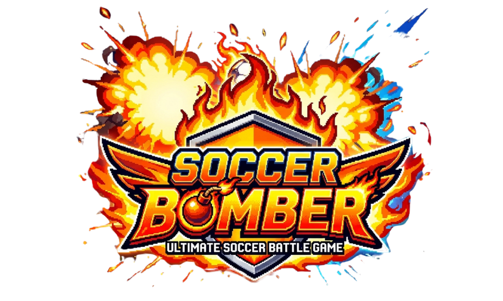
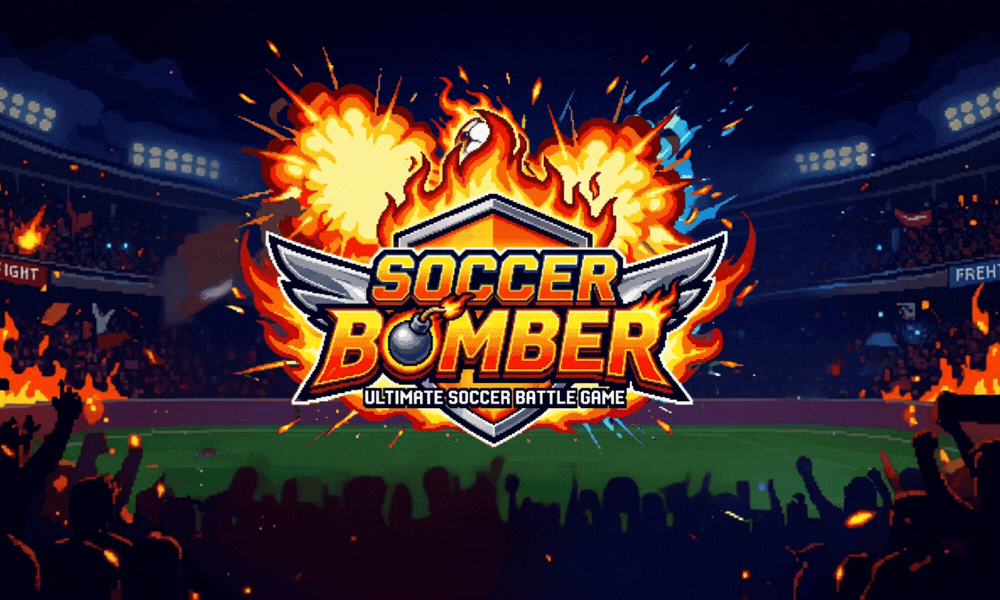

<p align="center">
  
</p>

<h1 align="center">⚽ Soccer Bomber</h1>
<p align="center"><strong>2D Turtle Football - Soccer Bomber Edition</strong></p>

<p align="center">
  <a href="https://www.python.org/"></a>
  <a href="https://docs.python.org/3/library/turtle.html"></a>
  
  
</p>

<p align="center">
  เกมฟุตบอล 2D แบบ Arcade สไตล์ Retro สุดมันส์ พัฒนาด้วยภาษา <strong>Python</strong> และโมดูล <strong>Turtle Graphics</strong> รองรับการเล่นแบบ <strong>Local 2-Player (Blue vs Red)</strong> แข่งขันกันทำประตูด้วยระบบฟิสิกส์ การกระโดด 2 จังหวะ (Double Jump) สกิลอัลติเมทประจำตัวละคร และระบบไฮไลต์ <strong>"Soccer Bomber Explosion"</strong> เมื่อบอลถูกบีบอัดจนระเบิด!
</p>

---

## 📸 ภาพตัวอย่างเกม (Screenshots)

<p align="center">
  
  <br>
  <em>หน้าจอเริ่มเกม (Title Screen)</em>
</p>

---

## ✨ ฟีเจอร์เด่น (Key Features)

- 🎮 **Local 2-Player Versus:** แข่งขัน 1 ต่อ 1 กับเพื่อนบนคีย์บอร์ดเดียวกัน ใครยิงครบ **7 ประตู** ก่อนเป็นฝ่ายชนะ
- 🦸 **4 ฮีโร่ที่มีสเตตัสและสกิลไม่ซ้ำกัน:**
  - ⚡ **Flash (Speedster):** วิ่งไว คล่องตัว มาพร้อมท่าไม้ตาย **Warp Shot** วาร์ปบอลเข้าหน้าประตูคู่แข่ง
  - 💥 **Titan (Power Striker):** ตัวใหญ่ แรงเตะมหาศาล สกิล **Heavy Impact** ซัดบอลพุ่งแรงพร้อมกระแทกคู่ต่อสู้ให้กระเด็นขึ้นฟ้า
  - 🦘 **Skyhopper (High Jumper):** กระโดดสูงกว่าใคร สกิล **Banana Curve** พุ่งขึ้นฟ้าแล้วยิงไซด์โค้งลงพื้น
  - ☄️ **Blaster (Ult Master):** สะสมเกจท่าไม้ตายได้ไวกว่าปกติ สกิล **Meteor Shot** ยิงกระสุนดาวตกความเร็วสูงเข้าเป้าหมาย
- 💣 **Soccer Bomber Explosion (ระบบระเบิดลูกบอล):** เมื่อผู้เล่นทั้งสองคนเข้าปะทะและบีบอัดลูกบอลบนพื้น แรงดันจะสะสมจนเกิดการระเบิด **"BOOM!!"** ซัดทั้งผู้เล่นและลูกบอลลอยกระเด็นขึ้นฟ้า!
- 🦘 **Double Jump & Animation:** กระโดดสองชั้นได้พร้อมวงแหวนคลื่นพลัง มีท่าทางการเดินและการเตะแบบไดนามิก
- 🥅 **Crossbar & Physics Interaction:** คานประตูมีมิติ สามารถเตะบอลชนคานเด้งกลับ หรือกระโดดขึ้นไปยืนตั้งหลักบนคานได้
- 🎬 **Ultimate Cutscene:** ฉากคัตซีนตัดภาพสลับสีสุดตื่นตาเมื่อกดใช้ท่าไม้ตาย
- 🔤 **Retro Minecraft Font:** ระบบโหลดฟอนต์พิกเซล `Minecraft.ttf` เข้าสู่โปรเซสแบบอัตโนมัติ

---

## 🎮 การควบคุม (Controls)

### 🔵 ผู้เล่นที่ 1 (Player 1 - Blue)

| ปุ่มกด | หน้าเมนูเลือกตัวละคร | ในเกม (Gameplay) |
| :---: | :---: | :---: |
| **A / D** | เลือกเปลี่ยนตัวละคร (ซ้าย / ขวา) | เคลื่อนที่ไปทาง ซ้าย / ขวา |
| **W** | - | กระโดด (กดซ้ำเพื่อ **Double Jump**) |
| **F** | ยืนยันการเลือกตัวละคร (READY) | **เตะบอล** (Kick) |
| **G** | - | **เปิดใช้งานท่าไม้ตาย** (เมื่อเกจเต็ม 100%) |

### 🔴 ผู้เล่นที่ 2 (Player 2 - Red)

| ปุ่มกด | หน้าเมนูเลือกตัวละคร | ในเกม (Gameplay) |
| :---: | :---: | :---: |
| **Left / Right** (ลูกศร) | เลือกเปลี่ยนตัวละคร (ซ้าย / ขวา) | เคลื่อนที่ไปทาง ซ้าย / ขวา |
| **Up** (ลูกศร) | - | กระโดด (กดซ้ำเพื่อ **Double Jump**) |
| **Enter** | ยืนยันการเลือกตัวละคร (READY) | **เตะบอล** (Kick) |
| **5** (หรือ **.** / Numpad 5) | - | **เปิดใช้งานท่าไม้ตาย** (เมื่อเกจเต็ม 100%) |

### ⚙️ ปุ่มส่วนกลาง (General)

| ปุ่มกด | ฟังก์ชัน |
| :---: | :---: |
| **Enter** | เริ่มเกมจากหน้า Title Screen / เล่นใหม่อีกครั้งหลังจบเกม |
| **Q** | ออกจากเกม (Quit Game) ในหน้า Game Over |

---

## 🏆 กติกาและระบบการเล่น (Game Rules)

1. **การนับคะแนน:** ฝ่ายที่เตะลูกบอลเข้าประตูฝั่งตรงข้ามจะได้ 1 คะแนน
2. **การตัดสินแพ้ชนะ:** ฝ่ายใดทำคะแนนได้ถึง **7 คะแนน** ก่อน จะเป็นผู้ชนะทันที
3. **ระบบเกจท่าไม้ตาย (Ultimate Gauge):**
   - เกจจะค่อยๆ เพิ่มขึ้นเองตามอัตรา `Ult Rate` ของตัวละคร
   - การเตะบอลจะช่วยชาร์จเกจเพิ่มขึ้นครั้งละ +8
   - เมื่อเกจเต็ม 100% สามารถกดปุ่มอัลติเมทเพื่อเข้าสู่สถานะ **READY!** (มีออร่ารอบตัว) และเมื่อสัมผัสหรือเตะบอลจะปลดปล่อยท่าไม้ตายทันที

---

## 📁 โครงสร้างโปรเจกต์ (Project Structure)

```text
SoccerBomber/
├── logo/
│   └── Logo.png         # โลโก้เกมพื้นหลังโปร่งใส (Transparent Logo)
├── Game.py              # โค้ดเกมหลัก (ลูปเกม, ระบบฟิสิกส์, เมนู, เสียง)
├── minecraft_font.py    # สคริปต์โหลดฟอนต์ Minecraft.ttf เข้าสู่ระบบ
├── Minecraft.ttf        # ฟอนต์พิกเซลสำหรับ UI ในเกม
├── Bg1.gif              # ภาพพื้นหลังหน้าเลือกตัวละคร
├── Bg2.gif              # ภาพพื้นหลังหน้าเริ่มเกม
├── bg.gif               # ภาพพื้นหลังสนามฟุตบอล
├── Count.wav            # เสียงนับถอยหลังเริ่มเกม (3.. 2.. 1..)
├── EnterStart.wav       # เสียงกดยืนยันเริ่มเกม
├── switch.wav           # เสียงเลื่อนเลือกตัวละคร
├── Kick.wav             # เสียงเตะบอล
├── Goal.wav             # เสียงเมื่อทำประตูได้
├── ultimate.wav         # เสียงคัตซีนท่าไม้ตาย
├── Start.wav            # เพลงประกอบหน้าแรกและในเกม
├── END.wav              # เสียงแสดงผลผู้ชนะ
└── README.md            # เอกสารประกอบโปรเจกต์
```

---

## 🚀 วิธีการติดตั้งและเริ่มเล่น (Installation & How to Run)

### 1. ความต้องการของระบบ (Prerequisites)
* **Python 3.8 ขึ้นไป** (แนะนำ Python 3.10+)
* รองรับระบบปฏิบัติการ **Windows** (เนื่องจากระบบเสียงดั้งเดิมใช้โมดูล `winsound` ซึ่งเป็น built-in ของ Windows)

### 2. ดาวน์โหลดโปรเจกต์
```bash
git clone https://github.com/<your-username>/SoccerBomber.git
cd SoccerBomber
```

### 3. รันเกม
```bash
python Game.py
```
*(หรือ `python3 Game.py` ขึ้นอยู่กับสภาพแวดล้อมระบบของคุณ)*

> **หมายเหตุสำหรับ macOS / Linux:**
> โค้ดปัจจุบันมีการเรียกใช้ `import winsound` ซึ่งมีเฉพาะบน Windows หากต้องการรันบน Mac/Linux สามารถปรับระบบเสียงไปใช้ไลบรารีอื่น เช่น `pygame.mixer` ได้

---

## 💡 เทคนิคและคำแนะนำการเล่น (Tips & Tricks)
* ใช้ **Double Jump** ในการโหม่งบอลข้ามหัวคู่ต่อสู้ หรือกระโดดบล็อกลูกยิงกลางอากาศ
* หากคู่ต่อสู้นำบอลไปบุกหน้าประตูของคุณ ลองเข้าไปเบียดแย่งบอลเพื่อกระตุ้น **Bomb Explosion** สวนกลับ!
* ฮีโร่ **Titan** มีแรงเตะสูงมาก สามารถยิงไกลจากแดนตัวเองเพื่อทำประตูได้อย่างรวดเร็ว

---


